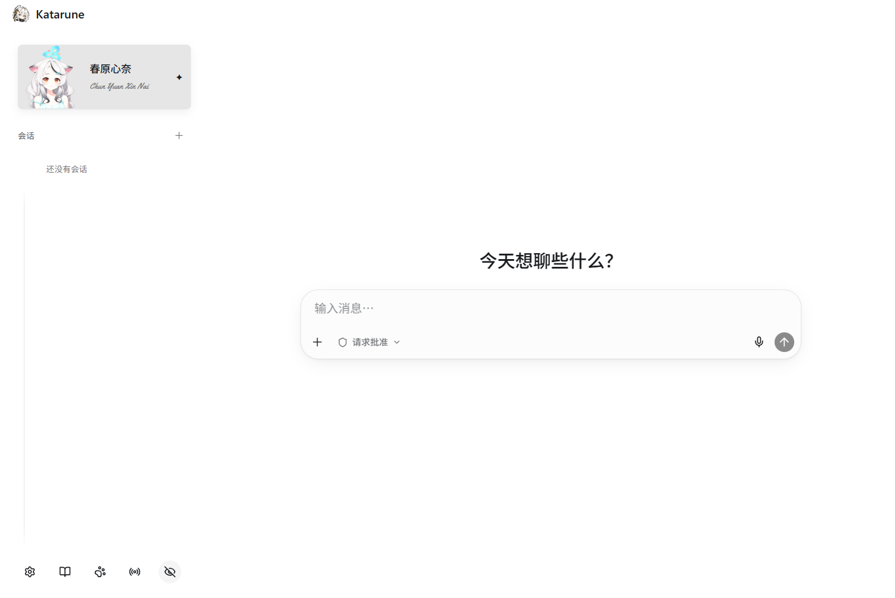
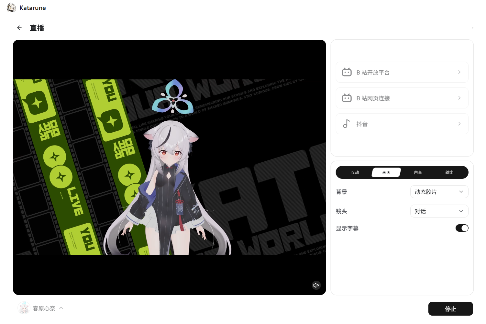

<div align="center">
  
</div>

# Katarune

> 新一代的数字伙伴~

Katarune，创造与你共同生活的数字世界。

互发消息、一起游戏，在虚拟世界中玩耍；未来，拥有自己的躯体，能够观察、移动，探索现实世界。这是我们希望一步步实现的愿景。

## 目前的体验

- **自由交谈**：流式文字对话、多会话历史，以及图片和文件附件；附件理解取决于所选模型的能力。
- **塑造角色**：自定义角色设定，为不同角色选择模型和音色，通过角色包更换立绘与 VRM 形象。
- **延续记忆**：每个角色拥有独立的本地记忆，记录相处中的偏好与重要信息，在后续对话中按需回忆。
- **动手探索**：角色拥有持久工作区，可处理已发送的文件、读取公开网页；每个会话可在聊天输入框底部选择请求批准或完全访问权限，控制目录和本机程序权限。
- **开口交流**：离线语音识别、自动断句和语音回复，支持桌面角色连续对话与插话。
- **桌面陪伴**：VRM 角色显示在桌面上，以字幕、口型、表情和已配置的动作回应，支持多屏与布局调整。
- **直播试用**：独立直播页面与会话，提供 B 站官方／网页连接与抖音网页接入，将角色画面和声音交给直播软件。B 站官方方式需要已获批项目及消息权限；网页方式扫码登录并识别自己的直播间。
- **由你选择**：自行配置模型供应商、兼容端点、对话模型和语音服务，按自己的需要组合伙伴的能力。






## 下载与使用

目前为 Alpha 版本，支持 Windows x64。下载安装后，在设置中配置模型供应商和 API Key 即可使用。

[下载 Windows 安装包](https://github.com/1sunxiaoshou/katarune/releases/download/v0.1.0/Katarune-Setup-0.1.0.exe)

## 从源码开始

使用 Node.js **24.21.0** 与 npm **11.19.0**：

```powershell
git clone https://github.com/1sunxiaoshou/katarune.git
cd katarune
npm ci
npm run dev
```

源码运行的语音识别与桌面角色需要额外准备。离线语音模型使用 `npm run asr:download` 下载；默认角色包已包含 VRM 与动作资源，Unity Player 的构建方式见[工程规范](docs/04-开发/工程规范.md)。仅运行 `npm run dev` 不会自动完成这些准备。

## 参与项目

欢迎通过 [Issues](https://github.com/1sunxiaoshou/katarune/issues) 分享使用反馈、报告问题或讨论新想法，也欢迎提交范围清晰的 Pull Request。

开发前请阅读[文档导航](docs/README.md)与[工程规范](docs/04-开发/工程规范.md)；使用编码 Agent 时，遵循 [AGENTS.md](AGENTS.md)。

## 致谢

感谢开源社区的分享与贡献，以下项目为 Katarune 的开发提供了技术支持与启发：

- [AI SDK](https://github.com/vercel/ai)
- [assistant-ui](https://github.com/assistant-ui/assistant-ui)
- [UniVRM](https://github.com/vrm-c/UniVRM)
- [sherpa-onnx](https://github.com/k2-fsa/sherpa-onnx)
- [Codex](https://github.com/openai/codex)

## 许可证

本项目原创源码采用 [Apache License 2.0](LICENSE)，允许在遵守许可证的前提下使用、修改和商业分发。

## 免责声明

本项目使用了部分第三方代码及角色、模型、动画、音乐等资产，相关权利归各自权利人所有，使用与传播须遵循其授权条款。

如您认为本项目中的内容侵犯了您的合法权益，请通过 [Issues](https://github.com/1sunxiaoshou/katarune/issues) 联系我们，并提供相关权属说明及内容位置。我们将在核实后及时删除或作相应处理。
